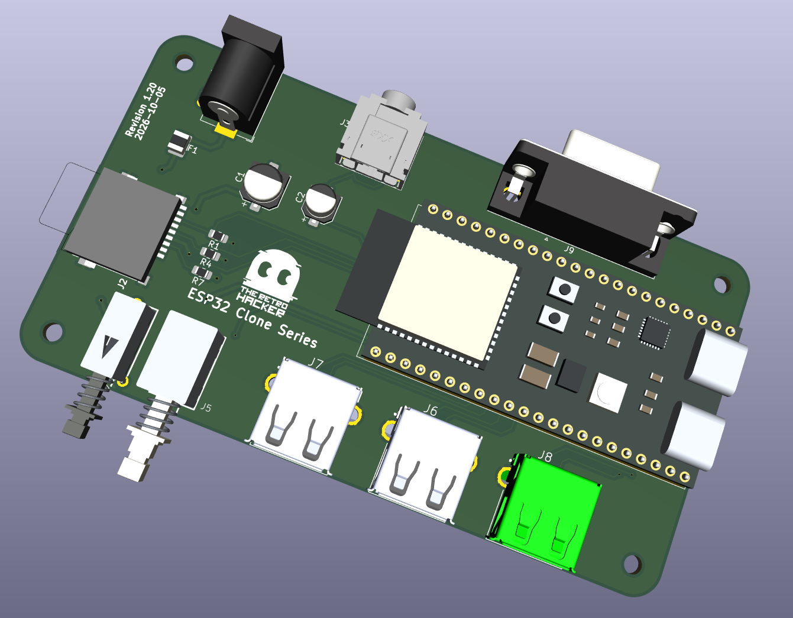
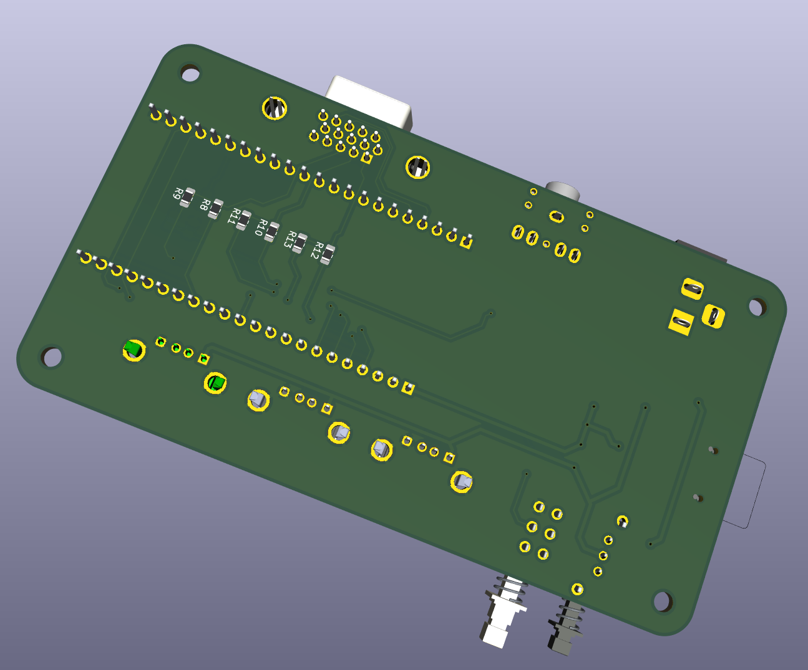

# The Retro Hacker Clone Series

The Retro Hacker Clone Series brings together hardware designs and source-available firmware to recreate and emulate classic computers from the 1980s and 1990s using modern ESP32-S3 based hardware.

 The board is designed to feel like a small retro computer rather than a bare dev board, and the firmwares are built to be practical, tweakable, and easy to build from a standard Git checkout.

At the moment the series includes eight emulator builds on the same ESP32-S3 board:

| Firmware | Covered machines | Project |
| --- | --- | --- |
| CP400 | Prologica CP400 / CoCo 2 | [Setup guide](software/esp32_cp400_emulator/README.md) and [change log](software/esp32_cp400_emulator/docs/log.md) |
| MSX | MSX1, MSX2, and MSX2+ | [Setup guide](software/esp32_msx_emulator/README.md) and [change log](software/esp32_msx_emulator/docs/log.md) |
| MSX TurboR (experimental) | Panasonic FS-A1ST | [Setup guide](software/esp32_msxturbor_emulator/README.md), [license report](software/esp32_msxturbor_emulator/docs/licenses.md) and [change log](software/esp32_msxturbor_emulator/docs/log.md) |
| TK90X / TK95 | Microdigital TK90X (48 KiB) and TK95 | [Setup guide](software/esp32_tk95_emulator/README.md) and [change log](software/esp32_tk95_emulator/docs/log.md) |
| Apple II | Generic Apple II+ and original Apple IIe | [Setup guide](software/esp32_apple2_emulator/README.md) and [change log](software/esp32_apple2_emulator/docs/log.md) |
| Macintosh Plus | Apple Macintosh Plus | [Setup guide](software/esp32_macplus_emulator/README.md) and [change log](software/esp32_macplus_emulator/docs/log.md) |
| Sega Master System | Sega Master System (NTSC / PAL) | [Setup guide](software/esp32_sms_emulator/README.md) and [change log](software/esp32_sms_emulator/docs/log.md) |
| Commodore 64 | Commodore 64 (PAL) | [Setup guide](software/esp32_c64_emulator/README.md), [licenses](software/esp32_c64_emulator/docs/licenses.md) and [change log](software/esp32_c64_emulator/docs/log.md) |

> **Development status:** all firmwares are under active development and at different maturity stages. The CP400 and MSX firmwares are the most mature; the others (including the experimental MSX TurboR) are earlier-stage and may be incomplete or change significantly.

All eight builds share the same board, VGA output, USB keyboard input, SD-card storage, and a simple F12 menu for setup and firmware updates.

## User guides

- [Quick Start](docs/quick-start.md): connect the monitor, keyboard and
  joysticks, turn on/reset the computer, and switch firmware through F12.
- [User Manual](docs/user-manual.md): SD-card preparation, controller
  compatibility, game-loading steps for all eight firmwares, and troubleshooting.

### Switching emulators

With the current updater and shared dual 4 MiB OTA layout installed, open
**F12 > Firmware update** in any emulator and select another emulator's
`.FLH` package. For example, MSX can install CP400, and CP400 can then
install Apple II. No renaming is needed. Copy the packages to the FAT32
card root (required by CP400's file picker), prepare the destination
emulator's ROMs using its setup guide, confirm the update and keep power
connected until the board restarts. The original FLH stays on the card.

Build packages with `make firmware` in each firmware folder. Older MSX,
TK and Apple updaters reject other emulator filenames: first update to
the current build of the **same** emulator. Older CP400 installations use
a smaller partition layout and require a **one-time UART upload** of a
current build before switching via SD. FLH updates replace only the
application, not the bootloader or partition table. Use current builds
for every destination so switching remains available after reboot.
Checksums detect corruption, not authenticity; install only trusted
firmware built for this board.

After building all eight packages, run
`powershell -ExecutionPolicy Bypass -File .\software\Test-FirmwareCompatibility.ps1`
to check the shared layout and all 64 source/destination combinations
against mock OTA storage. Physical-board switching still needs validation.

## Commodore 64

The [C64 firmware](software/esp32_c64_emulator/README.md) adapts the
CPU, CIA, VIC-II and SID from
[retroelec/T-HMI-C64](https://github.com/retroelec/T-HMI-C64) to the shared
VGA board. It includes a USB C64 keyboard matrix, two calibrated USB
joysticks with port swapping, PWM sound, PRG loading, read-only D64 program
extraction, the F12 configuration menu and interchangeable FLH firmware.
Supply your own BASIC, KERNAL and character ROMs. The initial version
does not emulate a 1541 drive, cartridges or tapes, and does not claim
cycle accuracy or verified physical-board performance.

## Why this exists

The goal is not to produce a display piece. This is meant to be a useful, buildable retro-computing emulation based platform: something that captures the character of a classic computer without needing a pile of original hardware on the bench.

The project sits between hardware design, emulator work, and preservation. It keeps the board layout, software, and documentation together in one place so someone can build, test, and modify it without digging through a dozen disconnected repos.

## CP400

The Prologica CP400 was one of the more recognizable Brazilian home computers of the 1980s. It was compatible with the Tandy/Radio Shack TRS-80 Color Computer 2, but it had its own industrial design, Brazilian-language software ecosystem, and local hardware expectations.

The [CP400 firmware](software/esp32_cp400_emulator/README.md) recreates that environment on ESP32-S3 hardware, including MC6809 emulation, VGA output, native USB keyboard support, joystick inputs, SD storage, virtual floppy handling, and the F12 configuration/update menu.

## MSX

The MSX has a very special place in Brazilian computing history. It officially arrived in Brazil in 1985 through two locally produced machines: the HotBit, from Sharp/Epcom, and the Expert, from Gradiente. At a time when Brazil’s computer market was heavily restricted and imported machines were difficult and expensive to obtain, the MSX became one of the country’s most important home-computing platforms. Its standardized architecture, large software library, expandability, and built-in BASIC introduced an entire generation not only to games, but also to programming, electronics, and computer technology. 

The [MSX firmware](software/esp32_msx_emulator/README.md) runs the original fMSX core on the same shared board. It includes multiple BIOS profiles for Omega MSX2+, Gradiente Expert 1.1, Sharp Hotbit 1.2, and Panasonic FS-A1WSX / FS-A1F / FS-A1FX.

The software supports the core MSX experience with USB keyboard input, graphics, sound, cartridge booting, and firmware updates through the on-screen menu. and... USB joystick support, of course.

The F12 Media menu attaches writable `.dsk` images to drives A/B and read-only `.cas` tapes, with ejection, tape rewind and optional saved boot defaults. Disk access requires a compatible user-supplied disk BIOS; see the [disk and tape setup guide](software/esp32_msx_emulator/README.md#disk-and-tape-images).

## MSX TurboR / Panasonic FS-A1ST

The experimental [MSX TurboR firmware](software/esp32_msxturbor_emulator/README.md)
recreates the Panasonic FS-A1ST using a source subset of blueMSX, separate
from the ordinary fMSX-based MSX build. It includes Z80/R800 switching,
DRAM mode, V9958 graphics, PSG, MSX-MUSIC, PCM output and writable
360/720 KiB `.dsk` images through the original disk interface.

Supply your own FS-A1ST firmware and Kanji ROMs under
`msxturbor/bios/fs-a1st` on the FAT32 card. See the
[SD card and ROM setup](software/esp32_msxturbor_emulator/README.md#prepare-the-sd-card),
[scope and limitations](software/esp32_msxturbor_emulator/README.md#implementation-scope-and-limitations)
and [licenses and provenance](software/esp32_msxturbor_emulator/docs/licenses.md).
The original BIOS boots into MSX BASIC in host tests; physical-board
performance, VGA/audio quality and firmware switching still require
validation. A1GT/MIDI and full-speed emulation are not claimed.

## TK90X / TK95

The Microdigital TK90X and TK95 brought the ZX Spectrum family of computers to Brazilian homes. The [TK firmware](software/esp32_tk95_emulator/README.md) emulates the TK95 and 48 KiB TK90X on the same shared ESP32-S3 board, using
the cycle-stepped chips Z80 core.

The firmware includes VGA output, USB keyboard input, beeper audio and two USB joystick ports with calibration and selectable Kempston, Sinclair 1/2 or Cursor interfaces. The F12 menu brings together machine and ROM selection, 50/60 Hz Microdigital ULA timing, Portuguese/Spanish ROM language selection, sound and volume, saved boot defaults, reset options and firmware updates.

Media support includes read-only standard `.tap` playback and loading 48K `.sna` and `.z80` snapshots. Supply legally obtained, raw 16 KiB ROMs at `tk\bios\tk95.rom` and `tk\bios\tk90.rom` on the FAT32 card; the `tk` folder can sit alongside `msx` and `cp400`. No ROM bytes are embedded in the firmware.

See the [SD card and ROM setup](software/esp32_tk95_emulator/README.md#sd-card-and-roms) and [keyboard guide](software/esp32_tk95_emulator/README.md#keyboard-and-joysticks) for the original TK keyword-entry conventions.

The initial release does not include AY audio, Betadisk, TZX, tape recording or snapshot saving, and does not claim full cycle accuracy. 

## Apple II

The [Apple II firmware](software/esp32_apple2_emulator/README.md) adds generic
Apple II+ (64 KiB with language card) and original Apple IIe (128 KiB)
profiles. It follows the shared standalone PlatformIO, board-driver, F12
configuration and FLH firmware-update conventions.

The initial integration uses
[codesafe/ESP32-VGA_AppleII_Emulator](https://github.com/codesafe/ESP32-VGA_AppleII_Emulator)
as its starting reference, with a cycle-stepped NMOS 6502 and additional
IIe banking and display support. VGA preserves the full width of
80-column text; USB keyboard, calibrated joystick/paddle input, speaker
audio and two read-only NIB Disk II drives are included.

Supply machine and Disk II ROMs under `apple2/bios` on SD. No ROMs or games
are distributed. Enhanced IIe/65C02 and Brazilian TK2000, TK3000/Compact,
MC-4000/Exato and Exato IIe profiles are not claimed as supported without
their required hardware and verified ROMs. See the
[scope and limitations](software/esp32_apple2_emulator/README.md#supported-media-and-limitations).
Physical-board validation is still pending.

## Macintosh Plus

The [Macintosh Plus firmware](software/esp32_macplus_emulator/README.md)
integrates a Musashi 68000 and Macintosh peripheral core with 4 MiB of
emulated RAM, a native 512x342 monochrome image centered on 640x480 VGA,
USB keyboard input, mono audio and the shared F12 menu and FLH updater.
A direct low-speed HID boot mouse connects to **joystick port 2**;
full-speed-only mice and USB hubs are unsupported.

Supply an unmodified 128 KiB Macintosh Plus ROM and a bootable whole
SCSI disk image under `macplus/bios` and `macplus/disks` on the FAT32 card.
No Apple ROM, operating system or disk image is bundled. See the
[SD card, ROM and disk setup](software/esp32_macplus_emulator/README.md#sd-card-and-rom),
[mouse compatibility](software/esp32_macplus_emulator/README.md#mouse-compatibility)
and [scope and validation](software/esp32_macplus_emulator/README.md#scope-and-validation).
This is an initial integration, not a claim of full-speed or cycle-accurate
emulation; floppy-media support is not implemented.

## Repository layout

```text
hardware/esp32_clones/          KiCad PCB and shared board files
hardware/esp32_clones/libraries Local KiCad symbols and footprints
hardware/esp32_clones/bom       Interactive BOM and BOM assets
hardware/cases/standard/       Parametric printed base, acrylic lid and manufacturing exports
software/esp32_cp400_emulator/  PlatformIO firmware for the CP400 build
software/esp32_msx_emulator/    MSX firmware and setup files
software/esp32_msxturbor_emulator/ MSX TurboR / Panasonic FS-A1ST firmware and setup files
software/esp32_tk95_emulator/   TK90X/TK95 firmware and setup files
software/esp32_apple2_emulator/ Apple II+/original IIe firmware and setup files
software/esp32_macplus_emulator/ Macintosh Plus firmware and setup files
images/                         Generated images and project documentation assets
```

## Board renderings

For the first enclosure prototype, see the
[standard case manufacturing files and engineering report](hardware/cases/standard/README.md).
P4 combines a printed base with easy-loading PCB nut traps, a screw-fastened
upper and a drilled 3 mm acrylic lid. Four M3 x 25 nylon screws pass down through
the acrylic into base nuts. Its vented alternative uses a separate matching
base with recessed bottom-entry screws and upper nuts. The acrylic cutting
pattern is [lid.dxf](hardware/cases/standard/lid.dxf); do not reuse the old
plain panel. See the report for dimensions and remaining physical-fit checks.

The Hotbit-inspired **Compact Classic C6** fits the same PCB in a
**124 x 74 x 39.1 mm** case, reducing the earlier Classic footprint by 26.9%.
It retains the miniature keyboard, photo-inspired colours and closed decorative
grille, with underside M3 cover screws. Use the matching
[base STL](hardware/cases/hb-8000/classic_base.stl) and
[upper STL](hardware/cases/hb-8000/classic_upper.stl); do not mix these with older
Classic or Wasteland halves. See the
[assembled/exploded preview](hardware/cases/hb-8000/classic_preview.png).
Print both STLs at 100%; the upper needs removable interior supports.
PCB screws remain M3 x 8 with 1 mm nylon washers; cover screws are M3 x 25 nylon,
with four M3 hex nuts for each set. Physical plug-fit and thermal tests are
still required; the decorative grille is not a ventilation opening.

The [Sony S2](hardware/cases/sony/README.md),
[Panasonic P2](hardware/cases/panasonic/README.md) and
[Apple II A3](hardware/cases/apple2/README.md) now share the C6 base and its
bottom-entry shell fastening. Their matching uppers replace the old clip joints.

The [Mac Plus-inspired M1](hardware/cases/mac/README.md) uses the same C6 base
under a **124 x 74 x 146.1 mm upright tower**, with a separate dark decorative
screen and miniature keyboard. Its blind floppy-slot detail, top grilles and
handle-shaped recess follow the supplied visual reference; no working display,
keyboard electronics or load-bearing handle is included. See the
[assembly and print-layout preview](hardware/cases/mac/mac_preview.png).

The [CP400-inspired CP1](hardware/cases/cp400/README.md) also reuses the C6
base in the compact **124 x 74 x 39.1 mm** envelope. Its left keyboard, raised
right panel and horizontal rear grilles follow the supplied photograph.
Integral and separate-keyboard upper options are available; red/green/cyan
accents in the [preview](hardware/cases/cp400/cp400_preview.png) are a painting
guide, not separate key pieces.

The [Master System-inspired SMS1](hardware/cases/sms/README.md) uses the same
C6 base and **124 x 74 x 39.1 mm** envelope, with an angular black console
shell and one separately printed red top-panel/front-stripe insert.
Cartridge/card slots and control shapes are decorative; no joystick or
controller is modelled. See the
[assembly and print-layout preview](hardware/cases/sms/sms_preview.png).

The PCB below is the current KiCad board layout for the shared ESP32 clone board. The front and back views are generated directly from the project PCB.

<div align="center">
  
  
</div>

For the full component-by-component assembly view, open the [interactive BOM](https://htmlpreview.github.io/?https://raw.githubusercontent.com/cristianoag/esp32_clones/blob/main/hardware/esp32_clones/bom/ibom.html).


## Hardware summary

The board is built around an ESP32-S3 DevKitC-style N16R8 module with 16 MB flash and 8 MB OPI PSRAM. It includes VGA output, a USB keyboard port, SD/MMC storage, a mono audio output, and a compact layout intended to behave more like a small computer than a bare dev board.

The shared board is used by all six firmware projects, and the pin mapping is documented in the [MSX hardware section](software/esp32_msx_emulator/README.md#hardware), the [MSX TurboR hardware section](software/esp32_msxturbor_emulator/README.md#hardware-and-dependencies), the [TK hardware section](software/esp32_tk95_emulator/README.md#hardware), the [Apple II hardware section](software/esp32_apple2_emulator/README.md#hardware) and the [Macintosh Plus hardware section](software/esp32_macplus_emulator/README.md#hardware).

## BOM and purchasing

This is the current BOM for the board as defined in the KiCad project. The table is meant to be a quick parts reference for ordering and build prep.

| Component | Description | Qty | Package | AliExpress |
| --- | --- | ---: | --- | --- |
| C1 | 220 µF electrolytic capacitor | 1 | 6.3x3 mm | [AliExpress](https://s.click.aliexpress.com/e/_c3vZZzuN) |
| C2 | 10 µF electrolytic capacitor | 1 | 5x4.5 mm | [AliExpress](https://s.click.aliexpress.com/e/_c3vZZzuN) |
| C4 | 100 nF ceramic capacitor | 1 | 0805 | [AliExpress](https://s.click.aliexpress.com/e/_c31gzw17) |
| C6 | 47 nF ceramic capacitor | 1 | 0805 | [AliExpress](https://s.click.aliexpress.com/e/_c31gzw17) |
| F1 | Resettable fuse / polyfuse | 1 | 1210 | [AliExpress](https://s.click.aliexpress.com/e/_c36cHi81) |
| J1 | DC barrel jack | 1 | Horizontal | [AliExpress](https://s.click.aliexpress.com/e/_c3D102dx) |
| J2 | Micro SD card socket | 1 | uSD | [AliExpress](https://s.click.aliexpress.com/e/_c3odXI41) |
| J3 | 3.5 mm audio jack | 1 | PJ-307 | [AliExpress](https://s.click.aliexpress.com/e/_c4DX94lF) |
| J4 | 12V power header / connector | 1 | PS-12E05 | [AliExpress](https://s.click.aliexpress.com/e/_c42cnGRn) |
| J5 | 5V power header / connector | 1 | PS-22F05 | [AliExpress](https://s.click.aliexpress.com/e/_c35YnsCh) |
| J6–J8 | USB-A connector | 3 | TE 6364372-2 | [AliExpress](https://s.click.aliexpress.com/e/_c4afTAHb) |
| J9 | DB15 video connector | 1 | D-sub 15-pin | [AliExpress](https://s.click.aliexpress.com/e/_c3K7eRWv) |
| R1, R4, R7 | 10 kΩ resistor | 3 | 0805 | [AliExpress](https://s.click.aliexpress.com/e/_c2zrvGiH) |
| R8, R10, R12 | 1.2 kΩ resistor | 3 | 0805 | [AliExpress](https://s.click.aliexpress.com/e/_c2zrvGiH) |
| R9, R11, R13 | 560 Ω resistor | 3 | 0805 | [AliExpress](https://s.click.aliexpress.com/e/_c2zrvGiH) |
| R2, R5 | 330 Ω resistor | 2 | 0805 | [AliExpress](https://s.click.aliexpress.com/e/_c2zrvGiH) |
| U1 | ESP32-S3-WROOM-1 module | 1 | ESP32-S3-WROOM-1 | [AliExpress](https://s.click.aliexpress.com/e/_c2uppnEv) |

## Firmware build notes

All six firmware projects use PlatformIO with the Arduino framework and a pinned `espressif32@6.11.0` platform. From the project directory you want to use, run:

```powershell
Set-Location .\software\esp32_cp400_emulator
# or:
# Set-Location .\software\esp32_msx_emulator
# or:
# Set-Location .\software\esp32_msxturbor_emulator
# or:
# Set-Location .\software\esp32_tk95_emulator
# or:
# Set-Location .\software\esp32_apple2_emulator
# or:
# Set-Location .\software\esp32_macplus_emulator

make firmware
```

The build produces FLH packages for each target; the project directories keep their own firmware images and configuration.
From `software`, run `make` to prepare the shared SD-card tree and copy each
emulator's highest-versioned `dist\ESP32_*-X.YY.FLH` package to that emulator's
project root and the root of `software\sdcard`. Firmware packages are copied
after merging the SD-card trees, including with parallel `make`.
Run `make firmware` there to copy packages only, or `make sdcard`
to prepare the SD-card tree only. Packages are not rebuilt; if any emulator is
missing a package, copying fails before any firmware files are copied. Existing
same-name files are replaced, and other files are preserved.
Each firmware directory includes its own board definitions and required
library sources and can be copied and compiled independently of the others.
All six still require PlatformIO and the configured ESP32 toolchain.

## ROMs and original software

Original CP400, CoCo, MSX, MSX TurboR, TK90X/TK95, ZX Spectrum, Apple II, Macintosh Plus, BASIC, cartridge, cassette, floppy and hard-disk software may still be copyrighted. This repository is for original hardware, firmware, and project files. Use legally obtained ROMs and software images when needed.

The CP400 firmware loads its BIOS files from `software/esp32_cp400_emulator/sdcard/cp400/bios`. Copy the `cp400` folder to the root of the microSD card so the firmware can read the BASIC, Extended BASIC, and CP400 or CoCo disk controller ROM selected in the F12 menu.

## Historical notes

The CP400 was part of the wider Brazilian TRS-Color ecosystem, the MSX line became one of the most important home computer families in Brazil, and Microdigital's TK90X and TK95 connected Brazilian users to the ZX Spectrum ecosystem. This project sits at the intersection of those histories: a practical board, six emulator builds, and a small bit of preservation work for machines that still matter to a lot of people.

## References

- [Prologica CP-400](https://en.wikipedia.org/wiki/Prol%C3%B3gica_CP-400)
- [CP400](https://pt.wikipedia.org/wiki/CP400)
- [TRS-80 Color Computer](https://en.wikipedia.org/wiki/TRS-80_Color_Computer)
- [MSX](https://en.wikipedia.org/wiki/MSX)
- [fMSX by Marat Fayzullin](https://fms.komkon.org/fMSX/)
- [TK90X](https://en.wikipedia.org/wiki/TK90X)
- [TK95](https://en.wikipedia.org/wiki/TK95)
- [ESPectrum reference emulator](https://github.com/EremusOne/ESPectrum)
- [chips Z80 core](https://github.com/floooh/chips)
- [Prologica](https://pt.wikipedia.org/wiki/Prol%C3%B3gica)
- [Datassette](https://datassette.org/)

## License


All hardware and firmware binaries in this repository are released under the Creative Commons Attribution-NonCommercial-ShareAlike 4.0 International license. Personal builds and community tinkering are encouraged, but commercial use or resale requires explicit authorization from the author.
